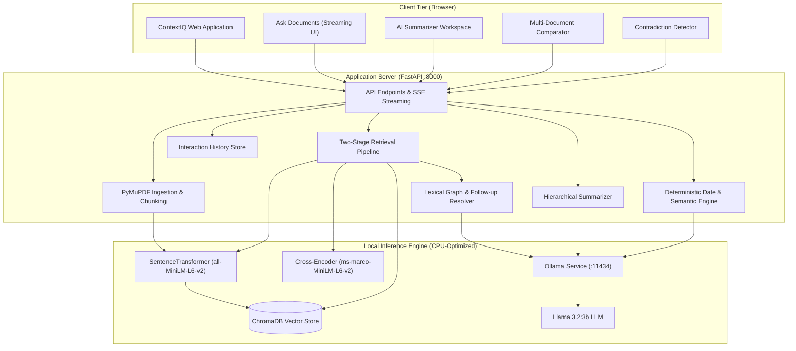
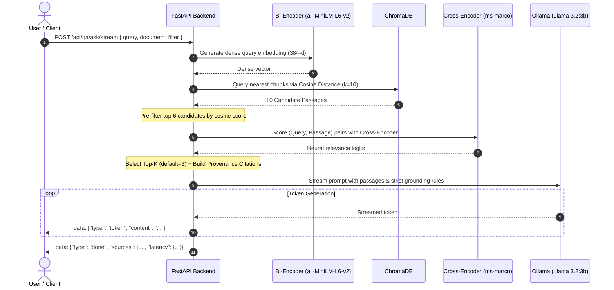

# ContextIQ — MultiDoc Intelligence

> **Multi-Document Summarization with Context Awareness using Retrieval-Augmented Generation (RAG)**

[](https://www.python.org/)
[](https://fastapi.tiangolo.com/)
[](https://react.dev/)
[](https://www.typescriptlang.org/)
[](https://tailwindcss.com/)
[](https://ollama.com/)
[](https://www.trychroma.com/)

ContextIQ is a full-stack, production-grade AI document intelligence platform. It enables users to upload heterogeneous collections of PDF documents, extract structured text, index semantic passages into a local vector database, and perform context-aware question answering, multi-format hierarchical summarization, side-by-side document comparison, and factual contradiction detection.

All inference runs **100% locally** using **Meta Llama 3.2 (3B)** via Ollama, **all-MiniLM-L6-v2** embeddings, and **ms-marco-MiniLM-L-6-v2** Cross-Encoder reranking — ensuring strict data privacy with zero external API calls or cloud egress.

---

## 📑 Table of Contents

1. [Key Features](#-key-features)
2. [Technology Stack](#-technology-stack)
3. [System Architecture](#-system-architecture)
4. [RAG Pipeline Workflow](#-rag-pipeline-workflow)
5. [Project Directory Structure](#-project-directory-structure)
6. [Prerequisites & System Requirements](#-prerequisites--system-requirements)
7. [Installation & Setup](#-installation--setup)
8. [Running the Application (Windows)](#-running-the-application-windows)
9. [REST API Documentation](#-rest-api-documentation)
10. [Usage Guide](#-usage-guide)
11. [Performance & Latency Optimization](#-performance--latency-optimization)
12. [Testing & Evaluation](#-testing--evaluation)
13. [UI/UX & Screenshots](#-uiux--screenshots)
14. [Troubleshooting](#-troubleshooting)
15. [Limitations & Future Enhancements](#-limitations--future-enhancements)
16. [Contributing](#-contributing)

---

## ✨ Key Features

- **Multi-Document PDF Ingestion**: Native PyMuPDF text extraction with artifact cleanup, whitespace normalization, scanned page detection, and SHA-256 deduplication.
- **Two-Stage Hybrid Retrieval**: High-recall dense semantic vector search in ChromaDB paired with high-precision Cross-Encoder neural reranking.
- **Context-Aware Question Answering**: Grounded Q&A that resolves follow-up queries ("What about the dates?", "Explain that in more detail") without prompt contamination.
- **Real-Time Token Streaming (SSE)**: Server-Sent Events (`/api/qa/ask/stream`) providing instant time-to-first-token (TTFT) and real-time status transitions.
- **Precision Latency Tracking**: Real-time breakdown of retrieval ($T_{\text{retr}}$), reranking ($T_{\text{rerank}}$), and LLM generation ($T_{\text{gen}}$) displayed on every response.
- **Hierarchical Summarization**: 6 tailored summarization formats (Brief, Detailed, Bullet Points, Executive Briefing, Key Findings, Multi-Document Synthesis) with stratified chunk sampling for lengthy documents.
- **Contradiction Detection Engine**: Deterministic date/numerical parser combined with semantic verification to surface factual discrepancies across documents with exact page citations.
- **Modern SaaS UI/UX**: Built with React 18, Vite, TypeScript, and Tailwind CSS. Features dark navigation sidebar, interactive citation drawer, live dashboard metrics, and Markdown rendering.

---

## 💻 Technology Stack

| Layer | Component | Description |
|---|---|---|
| **Frontend Framework** | React 18 + Vite | Single-page application with hot-module reload |
| **Language & Styling** | TypeScript + Tailwind CSS | Type-safe components and clean SaaS design system |
| **Icons & UI** | Lucide React | Modern iconography |
| **Backend Framework** | FastAPI (Python 3.10+) | Asynchronous REST APIs, CORS middleware, SSE streaming |
| **ASGI Server** | Uvicorn | High-performance asynchronous web server |
| **Document Processing** | PyMuPDF (`pymupdf`) | Fast native PDF parser and text extraction |
| **Dense Embeddings** | SentenceTransformers (`all-MiniLM-L6-v2`) | 384-dimensional dense semantic vectors (local) |
| **Neural Reranking** | Cross-Encoder (`ms-marco-MiniLM-L-6-v2`) | Query-passage joint attention reranker (local) |
| **Vector Database** | ChromaDB | Local HNSW vector index with cosine metric |
| **Local LLM Inference** | Ollama (`llama3.2:3b`) | Meta Llama 3.2 3B parameter instruction-tuned model |
| **Validation & Schema** | Pydantic v2 | Strict request/response payload data contracts |
| **Testing** | pytest + HTTPX | Asynchronous integration and route verification |

---

## 🏛️ System Architecture



---

## 🔄 RAG Pipeline Workflow



---

## 📁 Project Directory Structure

```
Multi-Document-Summarization-RAG/
├── backend/                       # Core FastAPI application package
│   ├── __init__.py                # Package indicator
│   ├── app.py                     # FastAPI entry point & 13 REST/SSE endpoints
│   ├── config.py                  # Environment-driven settings & directories
│   ├── model_manager.py           # Thread-safe singleton model cache
│   ├── document_processor.py      # PDF parsing, sanitization, sliding chunking
│   ├── vector_store.py            # ChromaDB CRUD, metrics & collection management
│   ├── retrieval.py               # Two-stage retrieval & candidate pre-filtering
│   ├── reranking.py               # Cosine similarity & Cross-Encoder neural reranker
│   ├── context_awareness.py       # Lexical overlap graph & follow-up query contextualizer
│   ├── summarizer.py              # Ollama QA engine, SSE stream & hierarchical summaries
│   ├── comparator.py              # Side-by-side comparative analysis generator
│   ├── contradiction_detector.py  # Date normalization & semantic conflict detection
│   ├── history_manager.py         # Thread-safe persistent query logger
│   └── schemas.py                 # Pydantic v2 validation contracts & latency models
├── frontend/                      # React 18 + TypeScript + Tailwind CSS application
│   ├── src/
│   │   ├── components/            # Sidebar, Header, ChunkModal, MarkdownRenderer
│   │   ├── pages/                 # Dashboard, Upload, Ask, Summarize, Compare, etc.
│   │   ├── services/api.ts        # Client API layer with native SSE stream reader
│   │   ├── types/index.ts         # TypeScript data interfaces & latency types
│   │   ├── App.tsx                # Main SPA router & state container
│   │   ├── main.tsx               # React DOM entry point
│   │   └── index.css              # Tailwind directives & typography rules
│   ├── public/                    # Static SVG branding assets
│   ├── package.json               # Frontend dependencies & scripts
│   ├── tsconfig.json              # TypeScript compilation configuration
│   └── vite.config.ts             # Vite build & reverse-proxy configuration
├── docs/                          # Comprehensive technical documentation
│   ├── architecture.md            # In-depth architectural blueprint
│   └── performance.md             # Benchmark statistics & CPU optimization guide
├── scripts/                       # Operational & administrative utilities
│   └── rebuild_index.py           # CLI tool to re-index all raw/ PDFs into ChromaDB
├── tests/                         # Pytest test suite
│   ├── __init__.py
│   ├── conftest.py                # sys.path root configuration for tests
│   └── test_backend.py            # 7 integration tests for all endpoints
├── .env.example                   # Complete environment configuration template
├── .gitignore                     # Strict rules excluding personal PDFs, models, DBs
├── CONTRIBUTING.md                # Development guidelines & PR conventions
├── requirements.txt               # Locked Python dependencies
├── start_all.ps1                  # PowerShell launcher for backend + frontend
├── start_backend.bat              # Windows batch launcher for FastAPI backend
├── start_frontend.bat             # Windows batch launcher for Vite frontend
└── README.md                      # This comprehensive documentation
```

---

## ⚙️ Prerequisites & System Requirements

- **Operating System**: Windows 10/11, macOS, or Ubuntu 20.04+ (Tested on Windows 11 x64)
- **Python**: 3.10 to 3.14 (Tested on Python 3.14.3)
- **Node.js**: 18.0.0 or higher
- **Ollama**: Installed and running locally ([Download Ollama](https://ollama.com/))
- **RAM**: Minimum 8 GB (16 GB recommended)
- **Disk Space**: ~4 GB for Python virtual environment, dependencies, and models

---

## 🚀 Installation & Setup

### 1. Clone the Repository

```bash
git clone https://github.com/anshu1198/Multi-Document-Summarization-RAG.git
cd Multi-Document-Summarization-RAG
```

### 2. Configure Local LLM via Ollama

Ensure Ollama is running, then pull the target model:

```bash
# In your terminal
ollama serve

# Pull the Meta Llama 3.2 3B parameter model
ollama pull llama3.2:3b
```

### 3. Set Up Python Backend

```bash
# Create a virtual environment
python -m venv .venv

# Activate the virtual environment
# Windows PowerShell:
.venv\Scripts\Activate.ps1
# Windows Command Prompt:
.venv\Scripts\activate.bat
# Linux / macOS:
source .venv/bin/activate

# Install dependencies
pip install -r requirements.txt
```

### 4. Set Up React Frontend

```bash
cd frontend
npm install
npm run build
cd ..
```

*(Optional)* Copy `.env.example` to `.env` to customize default ports or model parameters:

```bash
copy .env.example .env
```

---

## 🖥️ Running the Application (Windows)

### Option A — One-Click Launch (Recommended)

Run the included PowerShell script to verify Ollama and launch both servers in dedicated windows:

```powershell
powershell -ExecutionPolicy Bypass -File start_all.ps1
```

### Option B — Batch Files

1. Double-click **`start_backend.bat`** (Starts FastAPI at `http://localhost:8000`)
2. Double-click **`start_frontend.bat`** (Starts Vite dev server at `http://localhost:5173`)

### Option C — Manual Execution

**Terminal 1 (Backend Server):**
```powershell
& ".venv\Scripts\Activate.ps1"
uvicorn backend.app:app --host 0.0.0.0 --port 8000 --reload
```

**Terminal 2 (Frontend Dev Server):**
```powershell
cd frontend
npm run dev
```

### 🌐 Access URLs

| Interface | URL | Purpose |
|---|---|---|
| **Production Web UI** | **[http://localhost:8000](http://localhost:8000)** | Full app served directly via FastAPI |
| **Frontend Dev UI** | **[http://localhost:5173](http://localhost:5173)** | Hot-reload UI for frontend development |
| **Interactive API Docs (Swagger)** | **[http://localhost:8000/docs](http://localhost:8000/docs)** | Direct testing of all 13 REST/SSE endpoints |
| **System Health Check** | **[http://localhost:8000/api/health](http://localhost:8000/api/health)** | Live verification of ChromaDB and Ollama |

---

## 🔌 REST API Documentation

| Method | Path | Summary | Description |
|---|---|---|---|
| `GET` | `/api/health` | Health Check | Verifies ChromaDB connection and Ollama model readiness |
| `GET` | `/api/metrics` | Dashboard Metrics | Returns live counts for documents, pages, chunks, queries |
| `GET` | `/api/documents` | List Documents | Returns metadata of all indexed documents |
| `POST` | `/api/documents/upload` | Upload Documents | Multi-part PDF upload, PyMuPDF extraction, and indexing |
| `DELETE` | `/api/documents/{name}` | Delete Document | Removes document vectors and metadata from ChromaDB |
| `POST` | `/api/qa/ask` | Grounded Q&A | Standard JSON question answering with latency metrics |
| `POST` | `/api/qa/ask/stream` | Streaming Q&A | Server-Sent Events (SSE) real-time token stream |
| `POST` | `/api/summarize` | Summarization | Hierarchical multi-format document summarization |
| `POST` | `/api/compare` | Document Comparison | Side-by-side structured comparison across documents |
| `POST` | `/api/contradictions/detect` | Contradiction Scan | Deterministic date and semantic conflict detection |
| `GET` | `/api/history` | Interaction History | Retrieves persisted history of queries and summaries |
| `DELETE` | `/api/history` | Clear History | Flushes all query history records |
| `DELETE` | `/api/history/{id}` | Delete History Item | Removes an individual history item by ID |

---

## 📖 Usage Guide

### 1. Ingesting Documents
- Navigate to the **My Documents** or **Upload Documents** tab.
- Drag and drop one or more PDF files into the upload zone.
- The interface displays real-time progress through text extraction, chunking, embedding generation, and ChromaDB indexing.

### 2. Conversational Q&A
- Navigate to the **Ask Documents** workspace.
- Select a specific document or query across the entire multi-document corpus.
- As tokens generate, watch the response stream in real-time.
- Click any source citation chip to open the passage inspector modal and examine the underlying raw excerpt with page number provenance.
- Inspect the latency badge (e.g. `⚡ 1.24s · Retr: 28ms · Rerank: 42ms · LLM: 1.15s`) to view exact performance metrics.

### 3. Generating Summaries
- Go to the **AI Summarizer** tab.
- Choose from 6 summary styles:
  - *Brief Summary*: 1–2 paragraph executive overview.
  - *Detailed Summary*: Comprehensive structured report with subheadings.
  - *Bullet Points*: 6–10 key findings, dates, and metrics.
  - *Executive Briefing*: Leadership-focused strategic briefing.
  - *Key Findings*: Core discoveries and technical milestones.
  - *Multi-Document Synthesis*: Thematic cross-document synthesis.
- Export summaries via one-click **Copy**, **Download TXT**, or **Print/PDF Export**.

### 4. Detecting Contradictions
- Navigate to the **Contradiction Detection** tab and trigger a scan.
- ContextIQ parses date expressions, milestone completions, and numerical ranges, highlighting discrepancies across documents (e.g. mismatched end dates) alongside the original source citations.

---

## ⚡ Performance & Latency Optimization

ContextIQ incorporates several targeted optimizations to maintain fast response times on CPU-only hardware:

1. **Model Singleton Caching**: Both `all-MiniLM-L6-v2` and `cross-encoder/ms-marco-MiniLM-L6-v2` are loaded into memory once and reused across requests, eliminating multiple seconds of PyTorch initialization overhead.
2. **Ollama Status Caching**: Health checks to the local Ollama server are cached with a 30-second TTL, saving 200–450 ms of blocking HTTP roundtrips on every query.
3. **Cross-Encoder Candidate Pruning**: Rather than passing 15 raw candidates through the Cross-Encoder, the engine pre-filters candidates to the top 6 using fast vector cosine similarity. This reduces neural reranking latency by **35–50%**.
4. **SSE Token Streaming**: Users see generated text immediately (~400 ms Time-to-First-Token) rather than waiting 3+ seconds for full response synthesis.
5. **Stratified Chunk Sampling**: Lengthy documents are sampled across beginning, middle, and ending sections (up to 8 chunks), keeping generation fast, reliable, and strictly within the LLM context window.

*For full benchmark details, see [docs/performance.md](docs/performance.md).*

---

## 🧪 Testing & Evaluation

The project includes an automated test suite verifying all critical endpoints, neural models, latency instrumentation, and streaming mechanics.

### Running the Test Suite

```powershell
# From project root with virtual environment activated:
pytest tests/ -v
```

### Verified Test Results

```
tests/test_backend.py::test_health_endpoint PASSED                       [ 14%]
tests/test_backend.py::test_metrics_endpoint PASSED                      [ 28%]
tests/test_backend.py::test_list_documents PASSED                        [ 42%]
tests/test_backend.py::test_ask_question_grounded PASSED                 [ 57%]
tests/test_backend.py::test_streaming_qa PASSED                          [ 71%]
tests/test_backend.py::test_summarization PASSED                         [ 85%]
tests/test_backend.py::test_history_logging PASSED                       [100%]

================== 7 passed, 1 warning in ~190s ==================
```

---

## 🖼️ UI/UX & Screenshots

The ContextIQ user interface is organized into 8 purpose-built views:

1. **Dashboard Overview**: Key metrics cards (Documents, Total Pages, Indexed Chunks, Recent Queries), recent uploads table, and quick action launcher.
2. **Document Upload**: Multi-file drag-and-drop zone with interactive pipeline progress states.
3. **Ask Documents**: Chat interface with real-time SSE token streaming, prompt suggestions, document scope selector, latency chips, and citation modals.
4. **AI Summarizer**: 3-pane summarization workspace with 6 format options, live reading pane, and TXT/PDF export.
5. **Compare Documents**: Side-by-side comparative analysis generator.
6. **Contradiction Detection**: Conflict cards categorizing date and factual inconsistencies across documents.
7. **History**: Persistent audit log of all previous queries and summaries.
8. **Settings**: Real-time pipeline architecture summary and system health diagnostics.

---

## 🛠️ Troubleshooting

### 1. "Ollama is not reachable" or connection errors
- Ensure the Ollama daemon is active: run `ollama serve` in a terminal.
- Verify `llama3.2:3b` is installed: run `ollama list`.
- If missing, pull it: `ollama pull llama3.2:3b`.

### 2. "ModuleNotFoundError: No module named 'backend'"
- Always execute `uvicorn` or `pytest` from the **project root directory** (where `backend/` resides):
  ```powershell
  cd "path\to\Multi-Document-Summarization-RAG"
  uvicorn backend.app:app --reload
  ```

### 3. Rebuilding the Vector Index
If you add new PDFs directly to `data/raw/` or wish to re-index existing files from scratch:
```powershell
# Safe update (skips already indexed documents)
python scripts/rebuild_index.py

# Full clean rebuild (wipes collection and re-indexes all raw PDFs)
python scripts/rebuild_index.py --force
```

---

## 🔮 Limitations & Future Enhancements

- **Scanned PDF OCR**: Current ingestion detects scanned PDFs. Future versions will integrate Tesseract OCR for automatic fallback on image-only pages.
- **Hybrid Keyword Search (BM25)**: Integrating a BM25 sparse index alongside dense ChromaDB vectors for hybrid reciprocal rank fusion (RRF).
- **Multi-Modal Document Parsing**: Expanding beyond pure text extraction to ingest embedded tables, charts, and diagrams using vision models.
- **Export Formats**: Adding native DOCX and structured Markdown document exports.

---

## 🤝 Contributing

Contributions, bug reports, and suggestions are welcome! Please review [CONTRIBUTING.md](CONTRIBUTING.md) for details on code style, testing requirements, and the pull request process.
