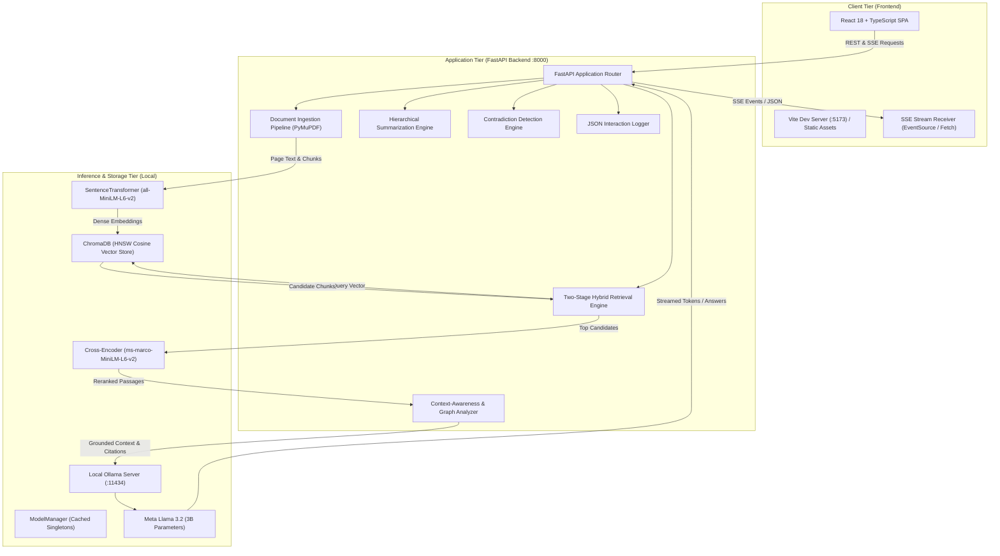
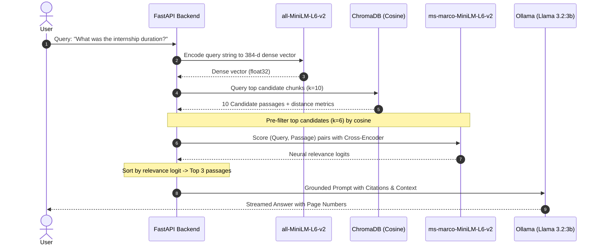

# ContextIQ System Architecture

This document provides a technical walkthrough of the **ContextIQ** multi-document retrieval-augmented generation (RAG) architecture, detailing data flow, neural models, vector storage, and algorithmic pipelines.

---

## 1. High-Level Architecture Diagram

---

## 2. Ingestion & Document Processing Pipeline

The ingestion pipeline handles heterogeneous PDF documents, extracting textual content, preserving structural provenance, and generating overlapping chunks suitable for semantic search.

1. **Extraction (`backend/document_processor.py`)**:
   - Uses **PyMuPDF (`pymupdf`)** for fast, high-fidelity native PDF extraction.
   - Normalizes non-printable characters, un-hyphenates broken words, and strips header/footer noise.
   - Detects empty, scanned (OCR-required), or corrupted pages to prevent blank vector indexing.
2. **Chunking**:
   - Uses a sliding window chunking algorithm: **180 words per chunk** with **30 words overlap**.
   - Preserves complete document metadata on each chunk:
     - `document`: Source filename
     - `page_number`: Origin page index
     - `chunk_id`: Deterministic unique identifier (`{doc_stem}_p{page}_c{chunk}`)
     - `word_count`: Exact length
     - `timestamp`: Ingestion time
3. **Deduplication**:
   - Computes SHA-256 hashes of incoming files to prevent duplicate indexing across uploads.

---

## 3. Two-Tier Retrieval & Neural Reranking

ContextIQ implements a **two-tier retrieval pipeline** optimized for CPU efficiency and high precision:

- **Stage 1: Dense Retrieval (Bi-Encoder)**
  - Model: `sentence-transformers/all-MiniLM-L6-v2` (384-dimensional dense vectors).
  - Stored in **ChromaDB** using an HNSW index with cosine distance (`hnsw:space: cosine`).
  - Fetches top candidate chunks (default $K=10$).
- **Stage 2: Neural Reranking (Cross-Encoder)**
  - Model: `cross-encoder/ms-marco-MiniLM-L6-v2`.
  - Performs cross-attention across the query and candidate chunk simultaneously, capturing fine-grained token-level interactions that bi-encoders miss.
  - **Performance Optimization**: Prior to running the heavier Cross-Encoder model, candidates are pre-filtered to the top 6 using fast cosine ranking, reducing inference time by ~40% on CPU while retaining recall.

---

## 4. Context Awareness & Graph Analysis

ContextIQ does not treat retrieved chunks as isolated islands; it models relationships across chunks and past conversational turns.

1. **Lexical Relationship Graph (`backend/context_awareness.py`)**:
   - Extracts non-stopword tokens from retrieved passages.
   - Computes pairwise Jaccard similarities and identifies shared thematic keywords.
   - Builds an adjacency matrix and computes connected components to group related topics.
2. **Conversational Follow-Up Resolution**:
   - Analyzes conversational history turns to resolve pronouns ("it", "that", "the second one") and implicit follow-ups ("What about the dates?").
   - Synthesizes a contextualized search query without polluting the LLM's prompt window with irrelevant prior context.

---

## 5. Local LLM Integration & Streaming

- **Model**: Meta `llama3.2:3b` hosted via local **Ollama** (`http://127.0.0.1:11434`).
- **Connection Caching**: Health probes are cached with a 30-second TTL to eliminate redundant HTTP checks before inference.
- **Strict Grounding Guardrails**: Prompts enforce zero outside-world hallucination. If retrieved passages do not contain facts to answer the question, the system falls back gracefully.
- **Server-Sent Events (SSE) Streaming**: Tokens are streamed to the frontend via `POST /api/qa/ask/stream`, providing low time-to-first-token (TTFT) and real-time status feedback (`retrieval` $\to$ `reranking` $\to$ `generation` $\to$ `done`).
- **Latency Breakdown**: Every request tracks exact wall-clock latency for:
  - $\text{Retrieval Latency } (T_{\text{retr}})$
  - $\text{Reranking Latency } (T_{\text{rerank}})$
  - $\text{Generation Latency } (T_{\text{gen}})$
  - $\text{Total Latency } (T_{\text{total}})$

---

## 6. Multi-Format Summarization & Contradiction Detection

- **Hierarchical Summarization**: For documents exceeding the local LLM context budget, the engine samples evenly distributed chunks across introduction, technical sections, and conclusions to produce holistic summaries without truncation.
- **Contradiction Detection**:
  - Deterministic date extraction parses and normalizes formats (`DD/MM/YYYY`, `Month DD, YYYY`, `YYYY-MM-DD`).
  - Matches shared attributes across documents (e.g. `internship_end_date`) and flags conflicting values with page references.
  - Semantic contradiction checks use grounded reasoning for non-date factual discrepancies.
